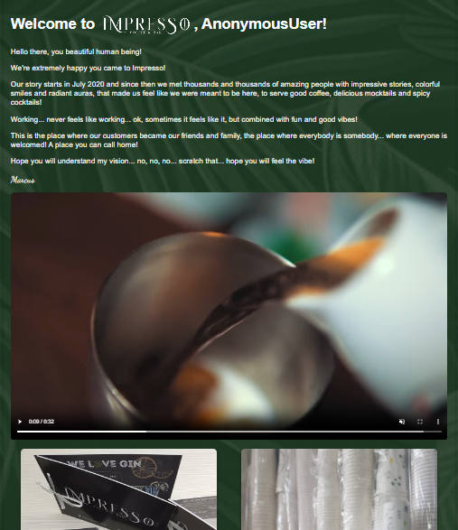
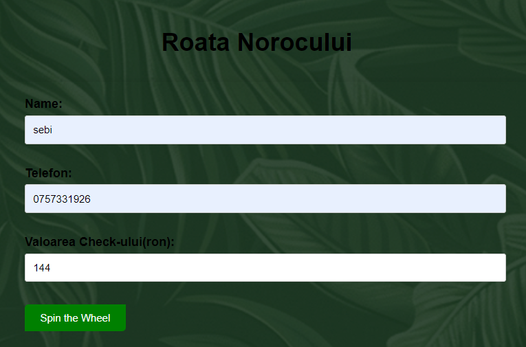
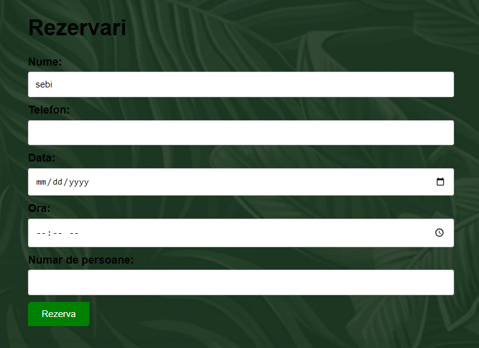
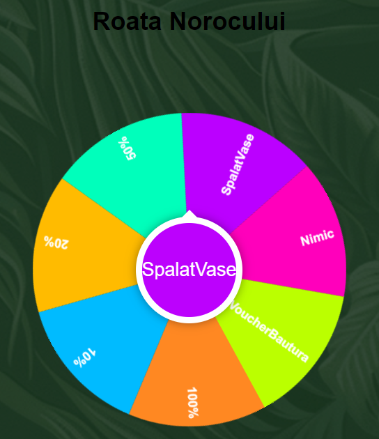
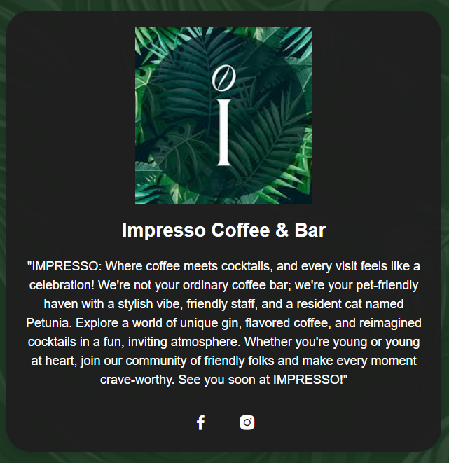

# Impresso — Coffee & Bar Management Web Platform

[](https://www.python.org/)
[](https://www.djangoproject.com/)
[](https://opensource.org/licenses/MIT)

A commercial web platform designed for **Impresso Coffee & Bar** (Brașov). The application delivers an engaging customer experience through online table reservations, interactive digital menus, and a gamified promotional campaign (**"Roata Norocului" / Wheel of Fortune**), coupled with dedicated administrative staff portals for managing bookings and client data.

---

## 📸 Screenshots

| Online Table Reservation | Gamified "Wheel of Fortune" |
|:---:|:---:|
|  |  |

| Staff Administrative Dashboard | Digital Menu & Brand Presentation |
|:---:|:---:|
|  |  |

| User Authentication (Login & Register) |
|:---:|
|  |

---

## ✨ Key Features

### ☕ Customer Facing
- **Online Table Booking**: Customers can schedule reservations by specifying date, time, party size, and contact details with real-time field validation.
- **Interactive "Wheel of Fortune" (Roata Norocului)**: Gamified loyalty feature allowing customers with valid receipt numbers to spin an animated wheel and win promotional prizes and drinks.
- **Digital Showcase**: Responsive landing page with media gallery, venue history, digital beverage menu, opening hours, and location maps.
- **Account Management**: User registration and authentication allowing clients to track their reservations.

### 🛡 Staff & Administration Portal
- **Reservation Control Center (`/staff/rezervari/`)**: Centralized view of all customer table bookings filtered by date and status.
- **Client Directory (`/staff/clienti/`)**: Database overview of registered clientele.
- **Prize & Promotion Logs (`/staff/roatanorocului/`)**: Real-time log of claimed receipt numbers and corresponding prizes won on the Wheel of Fortune.

---

## 🛠 Tech Stack

- **Backend**: Python 3.11+, Django 5.0 (MVC Architecture, ORM, CSRF protection)
- **Frontend**: Semantic HTML5, Modular CSS3, Vanilla JavaScript (animations, modal dialogs, spinning wheel physics)
- **Database**: SQLite (built-in, easily configurable for PostgreSQL / MySQL in production)
- **Design**: Customized dark/warm café-themed UI

---

## 📂 Project Structure

```
Impresso/
├── ImpressoApp/
│   └── WebApp/
│       ├── Impresso/                 # Main Django application
│       │   ├── migrations/           # Database schema migrations
│       │   ├── static/               # Assets (CSS, JS, logos, café imagery)
│       │   ├── templates/            # Django HTML templates (home, menu, reservation, staff)
│       │   ├── admin.py              # Django admin registrations
│       │   ├── models.py             # Data models (Reservation, Prize)
│       │   ├── urls.py               # Route definitions
│       │   └── views.py              # Controller & business logic
│       ├── WebApp/                   # Project configuration
│       │   ├── settings.py           # App settings & installed apps
│       │   └── urls.py               # Root URL configuration
│       └── manage.py
├── docs/                             # Academic documentation and presentation slides
├── screenshots/                      # Application preview screenshots
├── requirements.txt
├── .gitignore
├── LICENSE
└── README.md
```

---

## 🚀 Getting Started

### Prerequisites
- **Python** 3.10 or higher
- **pip** and **git**

---

### Installation & Run

1. Clone the repository:
   ```bash
   git clone https://github.com/NikitaSch2004/Impresso.git
   cd Impresso
   ```

2. Create and activate a virtual environment:
   ```bash
   python3 -m venv venv
   source venv/bin/activate    # On Windows: venv\Scripts\activate
   ```

3. Install requirements:
   ```bash
   pip install -r requirements.txt
   ```

4. Apply database migrations:
   ```bash
   cd ImpressoApp/WebApp
   python manage.py migrate
   ```

5. (Optional) Create an admin superuser:
   ```bash
   python manage.py createsuperuser
   ```

6. Start the server:
   ```bash
   python manage.py runserver 8000
   ```

7. Open your browser and navigate to:
   ```
   http://127.0.0.1:8000/
   ```

---

## 👤 Author

**Nikita Schimbătoru**
- GitHub: [@NikitaSch2004](https://github.com/NikitaSch2004)
- Email: nikitaschimbatoru@gmail.com

---

## 📄 License
This project is open-source under the [MIT License](LICENSE).
